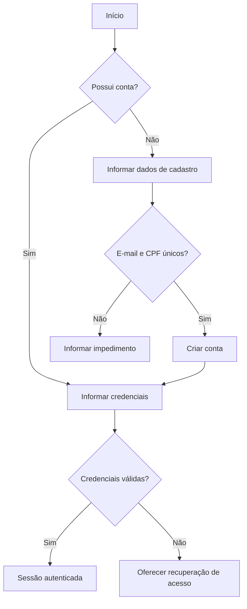
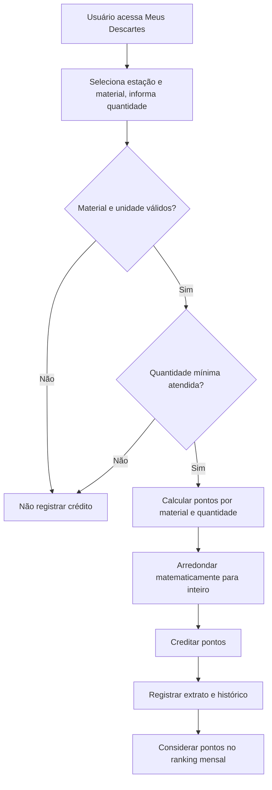

# Fluxos funcionais

Os fluxos representam o comportamento do MVP. A EcoDrop Station é uma interface de software e registra descartes em modo de simulação controlada. Balança, câmera, sensores e IA são **Futuro / Fora do MVP**.

## FLUXO 01 — Cadastro e autenticação

| Item | Descrição |
| --- | --- |
| Objetivo | Criar uma conta e iniciar sessão na plataforma. |
| Atores | AT01 — Usuário; Sistema |
| Início | Pessoa deseja acessar a plataforma. |
| Sequência principal | 1. Usuário informa nome, e-mail, CPF e senha. 2. Sistema verifica a unicidade de e-mail e CPF. 3. Sistema cria a conta. 4. Usuário informa credenciais. 5. Sistema autentica e inicia a sessão. |
| Decisões | A pessoa já possui conta? Então autentica-se ou recupera acesso. E-mail ou CPF já existem? O cadastro não é concluído. |
| Exceções | Credenciais inválidas impedem autenticação; detalhes do mecanismo de recuperação permanecem PENDENTES. |
| Resultado final | Usuário autenticado ou orientado conforme a condição encontrada. |
| Regras | RN014, RN015 |
| RFs | RF001, RF002, RF005 |

## FLUXO 02 — Consulta/localização de estação

| Item | Descrição |
| --- | --- |
| Objetivo | Encontrar e selecionar uma estação EcoDrop. |
| Atores | AT01 — Usuário; Sistema |
| Início | Usuário solicita a consulta de estações. |
| Sequência principal | 1. Sistema apresenta estações cadastradas. 2. Usuário pode consultar o mapa. 3. Usuário seleciona uma estação. 4. Sistema apresenta seus detalhes. |
| Decisões | Há estações disponíveis? Se não, sistema informa ausência de resultados. |
| Exceções | Estação não encontrada ou indisponível não pode ser selecionada para o fluxo. |
| Resultado final | Usuário conhece ou seleciona uma estação. |
| Regras | — |
| RFs | RF006, RF007, RF008, RF045 |

**PENDENTE:** detalhes definitivos da integração com mapas e dados apresentados por estação.

## FLUXO 04 — Descarte e geração de pontos

| Item | Descrição |
| --- | --- |
| Objetivo | Registrar descarte controlado e gerar pontos válidos. |
| Atores | AT01 — Usuário; Sistema |
| Início | Usuário autenticado acessa “Meus Descartes”. |
| Sequência principal | 1. Usuário seleciona estação e material, informa quantidade e confirma. 2. Sistema valida o mínimo aplicável. 3. Sistema calcula pontos conforme material e quantidade. 4. Sistema arredonda o resultado para inteiro. 5. Sistema credita pontos. 6. Sistema registra a movimentação, atualiza saldo, histórico e ranking mensal. |
| Decisões | Material é sólido ou óleo? Aplica kg ou litros e o mínimo correspondente. Quantidade é válida? Somente então há crédito. Primeiro descarte válido? Bônus pode ser aplicado se estiver configurado. |
| Exceções | Estação inativa, quantidade menor que o mínimo ou material inválido impedem crédito. |
| Resultado final | Descarte válido fica registrado e seus pontos são creditados; descarte inválido não gera pontos. |
| Regras | RN001–RN013, RN016–RN017, RN021, RN029–RN032, RN039 |
| RFs | RF015–RF019, RF022–RF025, RF028, RF037 |

**PENDENTE:** valor do bônus de primeiro descarte e valores de pontuação por material.

## FLUXO 05 — Consulta de histórico e extrato

| Item | Descrição |
| --- | --- |
| Objetivo | Acompanhar descartes, saldo e movimentações de pontos. |
| Atores | AT01 — Usuário; Sistema |
| Início | Usuário autenticado solicita uma consulta. |
| Sequência principal | 1. Usuário acessa histórico, saldo ou extrato. 2. Sistema apresenta os registros associados à conta. |
| Decisões | Há registros? Caso não haja, sistema informa a ausência de histórico ou movimentações. |
| Exceções | Acesso não autenticado não permite consulta da conta. |
| Resultado final | Usuário acompanha seus descartes, saldo e extrato. |
| Regras | RN009, RN012, RN013, RN021 |
| RFs | RF020, RF024, RF025 |

## FLUXO 06 — Ranking mensal

| Item | Descrição |
| --- | --- |
| Objetivo | Apresentar classificação mensal por pontos conquistados. |
| Atores | AT01 — Usuário; Sistema |
| Início | Usuário solicita o ranking. |
| Sequência principal | 1. Sistema considera pontos ganhos no mês. 2. Gera a classificação. 3. Exibe primeiro nome e inicial do sobrenome. 4. Apresenta a posição do usuário. |
| Decisões | Houve mudança de mês? Então inicia novo período, sem zerar saldo. Há pontuações no período? Se não, sistema apresenta a condição. |
| Exceções | Dados pessoais não devem ser expostos no ranking. |
| Resultado final | Ranking mensal e posição do usuário são apresentados. |
| Regras | RN029–RN033 |
| RFs | RF037, RF038, RF039 |

## FLUXO 07 — Catálogo e resgate de recompensa

| Item | Descrição |
| --- | --- |
| Objetivo | Consultar recompensas e confirmar resgate com pontos. |
| Atores | AT01 — Usuário; Sistema |
| Início | Usuário acessa o catálogo. |
| Sequência principal | 1. Sistema mostra recompensas disponíveis. 2. Usuário seleciona uma recompensa. 3. Sistema verifica saldo suficiente. 4. Usuário confirma. 5. Sistema debita os pontos e emite voucher quando aplicável. |
| Decisões | Recompensa está disponível e saldo é suficiente? Caso contrário, não confirma o resgate. Voucher é aplicável? Critério permanece PENDENTE. |
| Exceções | Saldo insuficiente ou recompensa indisponível impedem o resgate. Após emissão do voucher, usuário não pode cancelar. |
| Resultado final | Resgate confirmado, pontos debitados e voucher emitido quando aplicável. |
| Regras | RN022–RN024, RN036, RN039 |
| RFs | RF029, RF031, RF032 |

## FLUXO 08 — Utilização de voucher

| Item | Descrição |
| --- | --- |
| Objetivo | Validar e registrar um voucher como utilizado. |
| Atores | Sistema; AT01 — Usuário; AT02 — Administrador, quando necessário |
| Início | É solicitada a utilização de um voucher. |
| Sequência principal | 1. Sistema localiza o voucher. 2. Verifica validade e status. 3. Se válido e não utilizado, registra status utilizado. |
| Decisões | Voucher está expirado ou já utilizado? Então não pode ser utilizado. |
| Exceções | Voucher expirado não devolve pontos automaticamente. |
| Resultado final | Voucher é marcado como utilizado ou permanece sem utilização. |
| Regras | RN025–RN027 |
| RFs | RF034, RF035, RF045 |

**PENDENTE:** quem solicita a utilização e como ocorre a validação comercial. Parceiros não possuem painel no MVP.

## FLUXO 09 — Estorno administrativo

| Item | Descrição |
| --- | --- |
| Objetivo | Corrigir excepcionalmente uma operação por meio de estorno justificado. |
| Atores | AT02 — Administrador; Sistema |
| Início | Administrador identifica necessidade excepcional de estorno. |
| Sequência principal | 1. Administrador seleciona a operação. 2. Informa justificativa. 3. Sistema efetua o estorno. 4. Registra movimentação correspondente no extrato e a origem da operação. |
| Decisões | Há justificativa e autorização? Se não, estorno não é realizado. |
| Exceções | Falhas não podem deixar saldo e histórico inconsistentes. |
| Resultado final | Estorno rastreável, com justificativa e movimentação registrada. |
| Regras | RN013, RN028 |
| RFs | RF036 |

## FLUXO 10 — Administração do sistema

| Item | Descrição |
| --- | --- |
| Objetivo | Permitir que administradores gerenciem os recursos previstos. |
| Atores | AT02 — Administrador; Sistema |
| Início | Administrador autorizado acessa o painel. |
| Sequência principal | 1. Sistema valida o acesso administrativo. 2. Administrador escolhe usuários, estações, materiais/pontuação, recompensas, parceiros, premiações ou status. 3. Realiza ação permitida. 4. Sistema aplica a alteração. |
| Decisões | Administrador possui autorização? Se não, acesso é negado. A ação envolve status? Aplica apenas transições permitidas. |
| Exceções | Dados insuficientes, transição não permitida ou falta de autorização impedem a operação. |
| Resultado final | Recurso é consultado ou atualizado conforme permissão. |
| Regras | RN001–RN008, RN025–RN026, RN034–RN039 |
| RFs | RF009, RF026, RF027, RF030, RF040–RF045 |

**PENDENTE:** campos administrativos, ações permitidas sobre usuários e transições de status.

## Rastreabilidade

| Fluxo | Casos de uso | RFs | RNs principais |
| --- | --- | --- | --- |
| FLUXO 01 | UC001–UC003 | RF001, RF002, RF005 | RN014, RN015 |
| FLUXO 02 | UC004–UC005 | RF006–RF008, RF045 | — |
| FLUXO 04 | UC009–UC011 | RF015–RF019, RF022–RF025, RF028, RF037 | RN001–RN013, RN016–RN017, RN021, RN029–RN032, RN039 |
| FLUXO 05 | UC012–UC013 | RF020, RF024, RF025 | RN009, RN012, RN013, RN021 |
| FLUXO 06 | UC014 | RF037–RF039 | RN029–RN033 |
| FLUXO 07 | UC015–UC017 | RF029, RF031, RF032 | RN022–RN024, RN036, RN039 |
| FLUXO 08 | UC018–UC019 | RF033–RF035, RF045 | RN025–RN027 |
| FLUXO 09 | UC020 | RF036 | RN013, RN028 |
| FLUXO 10 | UC021–UC027 | RF009, RF026, RF027, RF030, RF040–RF045 | RN001–RN008, RN025–RN026, RN034–RN039 |

Requisitos não funcionais transversais: RNF004 (controle de acesso), RNF005 (validação no servidor), RNF006 (integridade), RNF007 (rastreabilidade), RNF008 (expiração de tokens de recuperação), RNF013 (privacidade), RNF015 (pontuação não dependente de valores livres do cliente) e RNF017 (auditabilidade de estornos).
